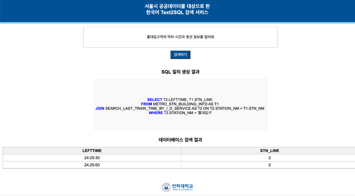
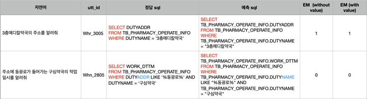
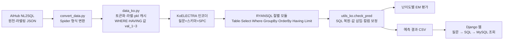
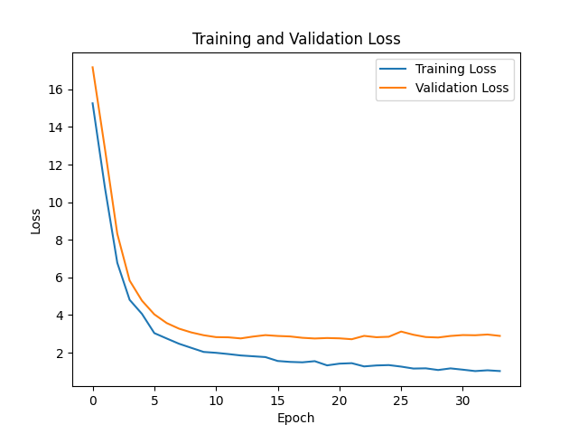

# 서울시 공공데이터 도메인 특화 Text2SQL

> 한국어 질문을 SQL로 바꾸는 RYANSQL 모델 개선 + 공공데이터 조회 웹 (졸업설계)



| 기간 | 인원 | 역할 | 상태 |
|---|---|---|---|
| 2024.02 ~ 2024.06 | 3명 (팀 Doorship) | 모델 학습·수정 (AI) | 완료 |

**Tech** `Python` `PyTorch` `Transformers` `KoELECTRA` `RYANSQL` `Django` `MySQL`

## 1. 개요
- **문제**: SQL을 모르는 공무원·시민은 공공데이터 DB 조회 곤란. 기존 RYANSQL은 WHERE 값을 `'#VALUE#'`로만 출력해 실제 DB 실행 불가, 한국어 '주소'·'이름' 컬럼 혼동 발생
- **목표**: AIHub 서울시 공공데이터 NL2SQL 데이터로 RYANSQL(KoELECTRA 인코더) 학습·개선 + 질문 → SQL → DB 조회 웹 구현
- **결과**: EM(with value) 전체 80.8 → 82.5 (+1.7%p), Hard 81.3 → 84.2 (+2.9%p) / '주소' 질의 컬럼 mismatch 90건 → 32건
- **팀 분담**: DB 스키마 재구성(PK·FK) 1명, 학습 데이터 증강 1명, 모델 학습·수정 및 모델 활용 API 1명(본인)

## 2. 주요 기능
- AIHub 원천·라벨링 데이터 → Spider 형식(`tables.json`, `train/valid/dev.json`) 변환 — `data/convert_data.py`
- 질문 + DB 스키마 토큰화·라벨 생성, pkl 캐시 — `data/data_ko.py`
- KoELECTRA(`monologg/koelectra-base-v3-discriminator`) 인코더 + 절별 slot-filling 디코더(Table·SELECT·WHERE·GROUP BY·ORDER BY·HAVING·LIMIT) — `src/models/model_ko.py`
- WHERE·HAVING 값 삽입(EM with value) — 라벨링 데이터 값(`val_1~3`)을 예측 SQL 조건 위치에 채움 — `data_ko.py` → `main_ko.py` → `model_ko.py` → `utils_ko.py`
- 컬럼 혼동 보정 — 1·2순위 컬럼 확률이 가까우면 KoELECTRA 임베딩 코사인 유사도로 재선택 — `src/utils/utils_ko.py`
- 학습·검증 루프, early stopping(patience 5), 손실 그래프 저장 — `src/training/main_ko.py`
- 예측 → SQL 복원, 난이도별(Easy/Medium/Hard/Extra Hard) 평가 — `src/utils/utils_ko.py`, `scripts/evaluate.sh`
- 자연어 질의 → SQL → MySQL 조회 웹(Django, 본인 구현) — 웹 코드는 레포 미포함

<!-- 데모 이미지: docs/images/ (가로 720px 이하) -->
| 데모: 예측 SQL 비교 (1행 값 삽입 성공, 2행 '주소'·'이름' 컬럼 혼동 사례) |
|---|
|  |

## 3. 아키텍처

- 질문 + 스키마(테이블·컬럼명) + SPC(statement position code)를 하나의 시퀀스로 KoELECTRA 입력
- 절별 분류기가 컬럼·집계·연산자·조건 개수 예측 → SQL sketch의 slot을 채워 조립, 조건 값은 라벨링 데이터에서 삽입
- 웹은 모델 예측 결과(CSV)에서 질문에 맞는 SQL 조회 → MySQL로 옮긴 공공 DB에서 실행해 표로 출력

## 4. 기술 스택
| 영역 | 기술 | 선택 이유 |
|---|---|---|
| 언어 | Python 3.8.10 | 기반 코드(RYANSQL 한국어 모델)가 Python |
| 모델 | RYANSQL (sketch 기반 slot-filling) | 한국어 Text2SQL 공개 모델, JOIN·HAVING 등 고급 SQL 생성 구조 |
| 언어모델 | KoELECTRA-base-v3 | GPT 등 LLM은 모델이 무겁고 한국어 데이터셋에 부적합하다고 판단 → 한국어 사전학습 인코더 |
| 프레임워크 | PyTorch 2.2.2, Hugging Face Transformers | 기반 코드가 PyTorch·Transformers로 구현 |
| 웹·DB | Django 5.0.6, MySQL | 예측 SQL을 실제 공공 DB에서 실행하기 위해 스키마 원본을 MySQL로 이관 (학습 시 SQLite → 타입·문법 변환) |
| 데이터 | AIHub 자연어 기반 질의(NL2SQL) 검색 생성 데이터 | 서울시 공공데이터 기반 한국어 질문-SQL 라벨링 데이터 |
| 학습 환경 | Ubuntu 20.04.5, NVIDIA RTX A6000, RAM 128GB, CUDA 12.1 | — |

## 5. 내 역할 및 기여
- 담당: 모델 학습·수정, 모델 활용 API 개발 (2024.05 중간발표 역할 분담표) — 설계·개발 파트 전담
- EM with value 구현 (2024.05.16~05.21): RYANSQL이 값 대신 `'#VALUE#'` 출력 → 라벨링 데이터의 WHERE·HAVING 값(`val_1~3`)과 질문 토큰을 데이터 로더 → 학습 루프 → 모델 → SQL 복원까지 전달, 배치 인덱스 기준으로 예측 조건 위치에 삽입
- 한국어 컬럼 혼동 보정 (2024.06.17): 질문에 '주소' 포함 + 1·2순위 컬럼 확률 차 15% 이내 → 컬럼명을 KoELECTRA로 임베딩해 코사인 유사도가 높은 컬럼 선택 — '주소' 질의 2,175건 중 mismatch 90건 → 32건 (레포 `utils_ko.py`는 SELECT 절에 적용한 실험 버전)
- 모델 구조·하이퍼파라미터 실험 (2024.06.03): TableClause 은닉층(Dense) 1개 추가 → 최종 설정 Table Clause 5층·Gen Clause 7층. GELU 활성화·은닉층 추가 증설은 성능 저하로 미채택 → Tanh, batch 32, lr 1e-6, dropout 0.1
- 학습 파이프라인 정비 (2024.05.23~05.30): GPU/CPU 자동 선택, 인코더 출력 device 정렬(`out.to(x.device)`), 학습·검증 손실 그래프 저장, `tables.json` 수정 시 pkl 캐시 재생성
- 레포 정리: 코드 업로드(18파일, 5,741줄), README·LICENSE 작성 — 커밋 13개 전부 본인
- 웹 데모: 질문 → SQL → MySQL 조회 Django 웹 구현 (학습 시 SQLite 스키마를 MySQL로 이관)

## 6. 트러블슈팅
| 문제 | 원인 | 해결 | 결과 |
|---|---|---|---|
| 예측 SQL의 WHERE 값이 `'#VALUE#'`로 출력돼 실제 DB 실행 불가 | RYANSQL은 컬럼·연산자만 예측하고 값은 placeholder로 대체 | 라벨링 데이터 값 `val_1~3`을 파이프라인 전 구간에 전달, 예측 조건 위치에 삽입 | EM with value 평가 가능. 예: `WHERE EMD_NM = "적선동" OR EMD_NM = "창신동"` |
| '주소'·'이름' 컬럼 혼동 (예: `DUTYADDR` ↔ `DUTYNAME`) | 영문 기반 모델 구조의 한국어 모호성, 1·2순위 컬럼 확률 근접 | 확률 차 15% 이내면 KoELECTRA 임베딩 코사인 유사도로 컬럼 재선택 | '주소' 질의 mismatch 90건(4.1%) → 32건(1.4%) |
| `tables.json` 수정 후에도 스키마 캐시 미갱신 | pkl 생성 조건문이 최초 1회만 동작 | 조건 반전으로 기존 pkl이 있으면 재생성 (임시 조치) | 스키마 수정 시 pkl 재생성 |


## 7. 성과
- 정량 (팀 결과, 지표: EM with value, 난이도 구분: Spider 기준)

| Hardness | Easy | Medium | Hard | Extra Hard | All |
|---|---|---|---|---|---|
| 개선 전 | 90.5 | 84.8 | 81.3 | 17.5 | 80.8 |
| 개선 후 | 91.8 | 86.1 | 84.2 | 18.6 | 82.5 |
| 변화 | +1.3%p | +1.3%p | +2.9%p | +1.1%p | +1.7%p |

- 한국어 컬럼 혼동: '주소' 포함 질의 2,175건 중 mismatch 90건(4.1%) → 32건(1.4%)
- 학습: 34 epoch에서 early stopping, 손실 Train 15.71 → 1.13 / Valid 17.13 → 2.78




- 정성: 학과 발표 3회 — 주제(2024.03), 중간(2024.05), 최종 포스터(2024.06) / 결과 논문 학과 제출(2024.06)

## 8. 실행 방법
```bash
git clone https://github.com/customer0907/capstone-nl2sql.git
cd capstone-nl2sql
pip install -r requirements.txt

# 1) AIHub 데이터를 download/1.Training 에 받은 뒤 Spider 형식으로 변환
python data/convert_data.py --src_folder download/1.Training --name train --data_path data/nia

# 2) 학습 (config.json 은 현재 디렉터리에서 읽음)
cp config/config.json .
PYTHONPATH=src/models:src/training:src/utils:data python src/training/main_ko.py --lang ko --train --batch_size 32 --device 0
```
- 2024.06 시점 실험 코드 스냅샷 — Spider 공식 평가 스크립트(`eval_final/`), 데이터, 체크포인트, Django 웹 코드 미포함, 재현 실행 미확인


## 9. 디렉터리 구조
```
capstone-nl2sql/
├── config/config.json        # 언어별(ko/en) 모델·데이터 경로·하이퍼파라미터
├── data/                     # AIHub → Spider 변환, 데이터 로더, SQL 파서
├── scripts/                  # evaluate.sh, parse_options.sh
├── src/
│   ├── models/               # model_ko.py(RYANSQL), tokenization.py
│   ├── training/             # main_ko.py, optimization.py, progressbar.py
│   ├── utils/                # utils_ko.py(SQL 복원·값 삽입·정확도)
│   └── decode.py             # 추론
├── docs/
│   ├── images/               # README 이미지
│   └── ORIGINAL_README.md    # 기존 README
├── LICENSE                   # Apache-2.0
└── requirements.txt
```

## 10. 회고
- 잘한 점: 오류 사례를 수치로 좁혀('주소' 질의 2,175건 중 90건) 원인 컬럼을 특정한 뒤 후처리로 보정
- 아쉬운 점: 조건 값을 질문에서 추출하지 않고 라벨링 데이터 값을 사용 → 실서비스에는 값 추출 모듈 필요. Extra Hard 18.6으로 JOIN·GROUP BY·HAVING 등 고급 SQL 예측 한계
- 다음 개선: 팀 내 업무 도구(git·Notion) 통일, 파트별 진행 보고 정례화

---
- 기반 모델: RYANSQL (카카오, *Computational Linguistics* 47(2), 2021) — AIHub NL2SQL 데이터와 함께 제공된 한국어 모델 소스코드를 수정
- 기존 README: [docs/ORIGINAL_README.md](docs/ORIGINAL_README.md)

